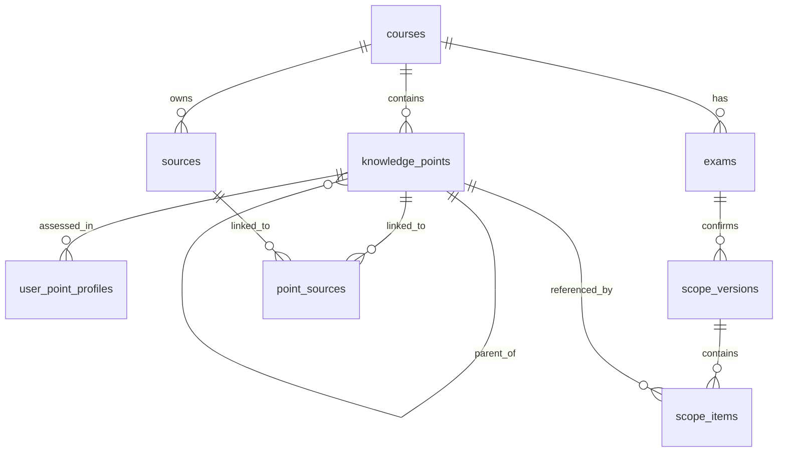

# T03 数据库设计草案：知识点、自评与未来扩展

状态：设计已由 javadeleon 确认（2026-11-15）；**本文不是已完成的模型或迁移**。下一步修改 `backend/app/db/models.py`，然后新增 Alembic 迁移。既有 `Course` 表和首条迁移不改写。

## 1. 设计目标和当前边界

当前要支持：一门课程的章节／知识点目录、单机用户的四档自评、独立的 AI 建议，以及后续多场考试的范围版本。删除或改名不应破坏历史引用。

T03 分三批落地：

1. **第一批：**`knowledge_points`、`user_point_profiles`；继续使用现有 `courses`。
2. **第二批：**`exams`、范围草稿、不可变正式范围版本和条目；补自评变更事件。
3. **第三批：**课程级 `sources`；知识点与来源的关联可随资料提取在 T08 增加。

第一版只在一台电脑上使用；现在不建登录接口，但档案表预留 `user_id`，当前固定为一个本机用户 ID。未来启用账号时，先建 `users` 并迁移既有本机数据，再给 `user_id` 加外键。不要现在引用不存在的 `users` 表。

## 2. 关系总览

`point_sources` 是后续关联表，不在第一批建。正式范围和用户自评都引用知识点，但不属于知识点本体。

## 3. 第一批表

### 3.1 `knowledge_points`：课程知识目录

| 字段 | 建议类型 | 规则与用途 |
| --- | --- | --- |
| `id` | `String(64)` | 主键；与现有 `Course.id` 和 API 的字符串 ID 风格一致，创建后不复用 |
| `course_id` | `String(64)` | 非空；外键到 `courses.id` |
| `parent_id` | `String(64)`，可空 | 自关联；空值为根节点 |
| `node_type` | `String(20)` | `chapter` 或 `point`；章节只组织目录，暂不计算个人掌握程度 |
| `name` | `String(160)` | 非空；长度与 `PointCreateRequest.name` 一致 |
| `sort_order` | `Integer` | 非负；同级节点的显示顺序，允许用户以后调整 |
| `created_at`、`updated_at` | 带时区意图的日期时间 | 创建及最后修改时间 |
| `archived_at` | 日期时间，可空 | 软删除标记；历史范围仍可引用 |

**数据库约束：**

- 主键：`id`。
- 外键：`course_id → courses.id`，`parent_id → knowledge_points.id`，默认限制物理删除。
- 唯一约束：`(course_id, id)`，供组合外键使用；`(course_id, parent_id)` 同时引用父节点的 `(course_id, id)`，从数据库层防止跨课程挂接。
- 检查约束：`node_type IN ('chapter','point')`、`sort_order >= 0`、`parent_id IS NULL OR parent_id <> id`。
- 索引：`(course_id, parent_id, sort_order)`，方便按课程和章节读取目录。

**服务层还必须检查：**父节点是否归档、父节点类型是否为 `chapter`、多层父子循环、知识点是否允许挂到该层级。单行 `CHECK` 不能检查跨多行循环。

不把同名知识点全局设为唯一：不同章节可以出现同名概念。若要禁止同一父节点下重名，应由服务层先定义“大小写、空格、根节点”规则，再决定数据库唯一索引，不能草率添加 `UNIQUE(course_id,parent_id,name)`。

### 3.2 `user_point_profiles`：当前掌握状态

| 字段 | 建议类型 | 规则与用途 |
| --- | --- | --- |
| `user_id` | `String(64)` | 联合主键一部分；当前为固定本机用户 ID，暂不指向 `users` |
| `point_id` | `String(64)` | 联合主键另一部分；外键到 `knowledge_points.id` |
| `self_status` | `String(20)` | 非空；`not_started / not_mastered / basic / mastered` |
| `ai_status` | `String(20)`，可空 | AI 建议，与用户自评分开；没有证据时为空 |
| `version` | `Integer` | 从 1 开始；`PUT /points/{point_id}/self-status` 用于乐观并发校验 |
| `self_updated_at` | 日期时间 | 用户最后一次主动修改时间 |
| `ai_updated_at` | 日期时间，可空 | AI 最近一次评估时间 |

主键为 `(user_id, point_id)`，确保一个用户对一个知识点只有一份**当前**档案；`point_id` 外键限制物理删除。状态值和 `version >= 1` 应有检查约束。用户修改自评时只更新 `self_status/version/self_updated_at`，不能顺手改 `ai_status`。

当前单用户可在创建 `point` 节点时为本机用户创建初始档案，状态为 `not_started`、版本为 1；章节节点不建档案。未来新账号的档案可在首次读取或首次学习时建立。API 的 `Point.version` 对应**当前用户档案版本**，不应混同目录节点的结构版本。

**不采用 0～100 作为自评主字段。** 本项目契约已经把自评定义为四档；正确率可以从练习记录计算并另存为 AI 评估依据。把“60 分”和“基本掌握”同时当作权威状态会造成两套规则冲突。

## 4. 历史、删除与改名

`user_point_profiles` 只保存当前状态。第二批增加追加式 `point_profile_events`，建议字段为 `id, user_id, point_id, field_name, old_value, new_value, actor, created_at`；`field_name` 区分自评与 AI 建议，`actor` 区分用户与 AI。AI 更新自身建议时只记录 `ai_status` 事件，不能伪装成自评变化。一次状态修改应在同一事务中更新当前档案并写事件，失败时一起回滚。做题和学习时长等更广义活动记录留给后续学习模块，避免把所有事件塞进一个含糊的 `learning_records.result_data`。

现有课程通过 `archived_at` 归档；知识点也用 `archived_at`。界面默认隐藏归档记录，历史范围、错题和计划仍可解析其 ID。归档章节时要明确处理子节点：推荐整棵子树一起归档，并在确认前展示影响；恢复时也要定义是否连带恢复。T03 尚无删除接口，先确定规则，不急着写删除代码。

知识点改名保留相同 ID。历史考试范围的条目应保存 `point_name_snapshot`，使当年的范围显示当年的名字；当前知识目录仍显示新名字。不要为了改名复制一个新知识点 ID。

## 5. 第二批：考试范围版本

| 表 | 核心键与字段 | 关键规则 |
| --- | --- | --- |
| `exams` | 字符串 `id`、`course_id`、`name`、`exam_date` | 一门课程可有多场考试；日期不放到课程或知识点表 |
| `scope_drafts` 与草稿条目 | `exam_id`、`draft_version`、`point_id`、`included`、`priority` | 草稿可为空，覆盖式保存需比对 `expected_version`；`included=false` 表示明确不考 |
| `scope_versions` | 字符串 `id`、`exam_id`、`version_no`、`confirmed_at` | `UNIQUE(exam_id,version_no)`；确认后不可原地改写 |
| `scope_items` | `scope_version_id`、`point_id`、`included`、`priority`、`point_name_snapshot` | `UNIQUE(scope_version_id,point_id)`；保留确认时的完整判断，计划只读取 `included=true` |

确认范围须在一个事务内完成：验证草稿非空、至少一个 `included=true`、全部知识点属于考试课程，再写新版本与条目。草稿或正式范围变化都不能删除知识点档案。读取历史版本使用 `GET /exams/{exam_id}/scope?version=N`；不传 `version` 读取最新版本。

## 6. 第三批：资料来源

T03 契约按**课程**登记链接或笔记，因此先建 `sources(id, course_id, kind, title, uri?, note_text?, status, created_at)`。一个来源可能服务多个知识点，一个知识点也可能引用多个来源；后续使用 `point_sources(point_id, source_id, relation_kind)` 做多对多关联，而不是把 `course_id` 替换成单个 `point_id`。文件路径、校验和、正文片段、页码与提取任务在 T08 扩展。

笔记的 `note_text` 保存用户输入的原文；链接的 `uri` 只保存地址。状态 `registered` 只表示登记成功，不能给用户展示为“已提取正文”。

## 7. 工程约束与验收

1. **迁移向前追加。** `e319e4b241e9_create_courses.py` 是已执行的历史迁移；新增表写新 revision，不改旧 revision。
2. **SQLite 外键需要显式启用并测试。** 应用连接与 Alembic 测试连接都要验证 `PRAGMA foreign_keys=ON`；否则写了外键也可能无法阻止错误数据。
3. **事务边界明确。** 服务层负责一次业务操作的提交／回滚；仓储函数不各自偷偷 `commit`，否则范围确认和档案事件无法原子完成。
4. **版本防覆盖。** 更新自评和范围草稿先比较客户端 `expected_version`；不匹配返回 409，保留原数据。
5. **测试用临时库。** 验证跨课程父节点被拒绝、自身为父节点被拒绝、章节无档案、用户自评不覆盖 AI 建议、重复迁移不丢记录、旧范围版本可查。
6. **契约同步。** `Point` 契约已加入 `node_type/sort_order`；章节的 `self_status/ai_status/version` 为 `null`，知识点的 `version` 是档案版本。 `Source` 契约采用课程级来源，范围读取支持指定 `version`。

## 8. 需要带着走的设计取舍

- **知识点与档案分开：**一个知识目录可供多场考试和未来多个用户复用；学习变化不会修改课程结构。
- **当前状态与历史事件分开：**列表读取快，仍能追溯“什么时候、谁把状态改成了什么”。
- **软归档与限制物理删除：**保护考试、错题和计划的历史引用；付出的代价是所有常规查询必须过滤 `archived_at`。
- **草稿与正式版本分开：**用户可以反复试选考点，确认后得到可追溯快照；旧计划可以指向当时的范围版本。
- **来源按课程保存，再做关联表：**同一份教材不必复制到每个知识点；后续可给一段教材关联多个知识点。
- **字符串 ID 与四档状态：**遵守已存在的模型与 API 契约，避免第一批迁移就引入不兼容的 ID 或第二套掌握度定义。
