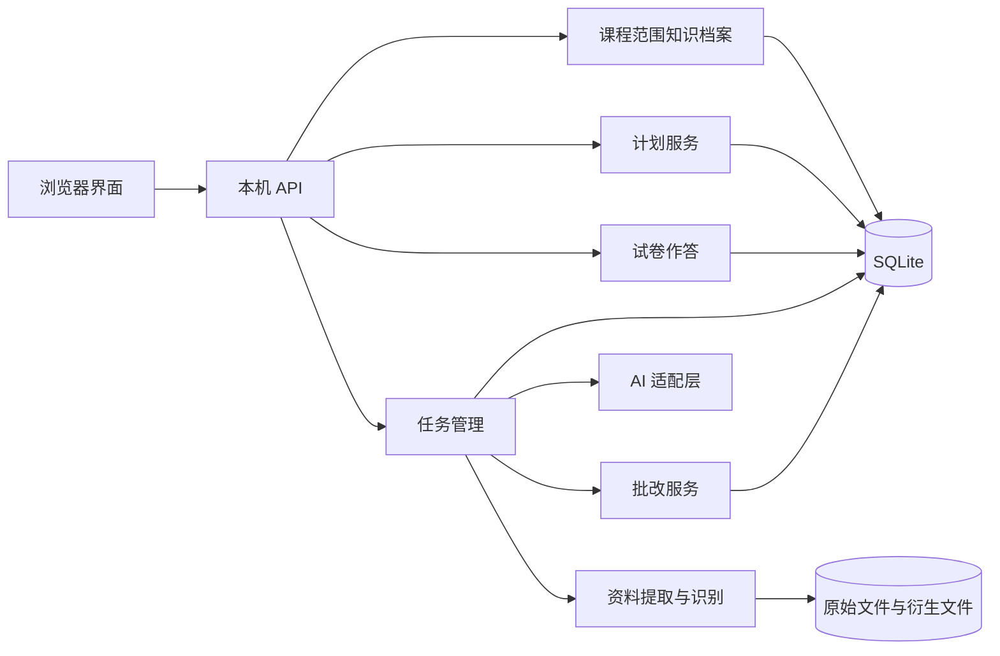
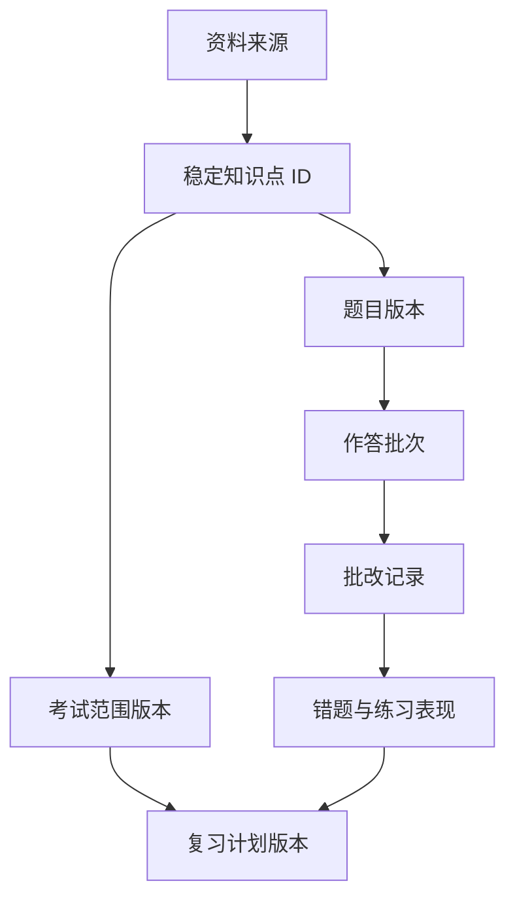
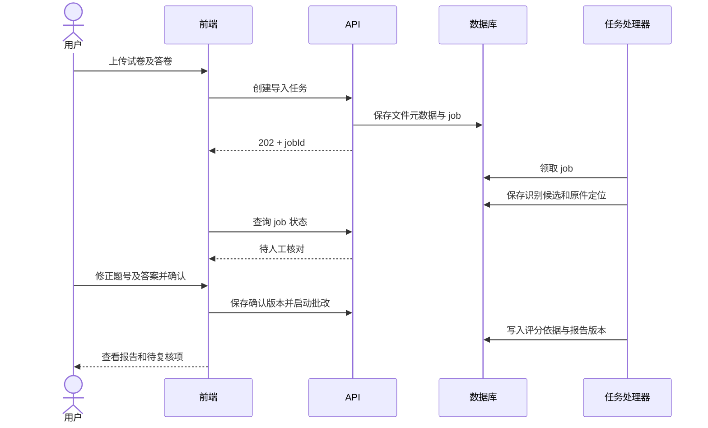
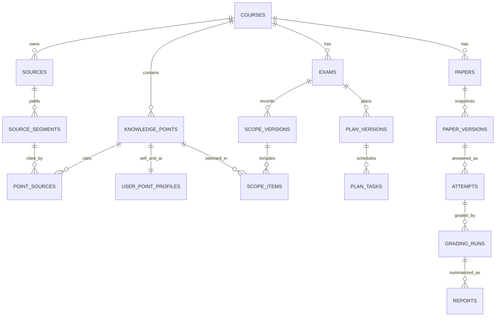

# 期末复习助手技术设计与双人开发计划

版本：技术设计草案 0.2　初稿：2026-10-31　更新：2026-11-04　状态：供两人讨论与实施，未定事项不得视为最终决定

> 本文是编码、联调和验收依据。标记说明：【已确认】来自用户近期决定；【建议方案】工程建议；【待确认】需要团队作决定；【假设】为了继续设计采用的临时前提。原有 HTML 是交互原型，不是正式前端代码，也不代表 AI、OCR 或批改已经接通。

## 第1章 项目概述与需求分析

### 1.1 定位与约束

【已确认】项目名称暂用“期末复习助手”，目标是帮助大学生围绕自己的考试范围学习、做题、批改和调整复习计划。两名学生以学习优先方式开发：先做浏览器版，再封装桌面端；首版先在同一台电脑使用，不要求离线；AI 通过外部 API 调用；首版尽可能覆盖 PDF／图片导入与主观题辅助批改。未来考虑账号、云端同步与多人数据隔离。【待确认】明确交付日期、预算、模型供应商、首版必须演示的材料种类和打印输出格式。

用户的核心问题：材料分散；教材与教师实际考查范围不一致；不知道先学什么；听懂与会做之间有落差；纸质及在线答卷难统一分析；临时无法学习时计划容易失效。

【已确认，2026-11-04】每日可学习时间按用户的全局日期记录。同一天所有课程的任务合计不得超过当天可用分钟数；全天不可学习对所有课程生效。考试范围、任务和计划版本仍分别属于具体考试。

### 1.2 使用场景与边界

1. 仅输入课程名也可建课，之后逐步添加教材、PPT、PDF、视频链接、网页、笔记、试卷。
2. 用户确认本次考试范围、重点和日期，单独维护知识点自评；AI 建议与自评分开。
3. 用户查看每日任务，标记全天或部分不可学习，先预览补排，再确认应用，可撤销。
4. 用户进入分步讲解、练习或长篇幅模拟卷；在线答题可退出后恢复。
5. 用户导入外部试卷与答卷，核对题号、公式及答案对应后再辅助批改。
6. 报告和错题回流知识档案与后续计划；历史成绩与原始作答不被重写。

【边界】首版是单机个人软件，不设计公开多用户站点。用户可提供链接，但无法保证所有网站都能取得正文；不可访问的来源提供粘贴、上传或仅保存链接的替代路径。没有可靠答案或评分标准的主观题只能给参考评分与待复核状态。右下角形象只用于简短鼓励，不承担 AI 对话或批改。

非功能要求：本机数据重启后不丢失；长任务可查询状态和重试；保存、识别、评分均显示来源和不确定性；重要状态变更留版本；常用页面可读且支持键盘操作；接口密钥不送到浏览器；错误时保留输入。性能目标暂定为普通课程列表和计划操作在本机无明显等待，文件处理与 AI 请求以阶段状态反馈，不伪造进度百分比。【待确认】具体时延与文件大小上限。

### 1.3 实施范围

【建议方案】把首版拆成四个持续可运行的迭代，而非一次写完才集成：A 数据骨架；B 在线学习和答题闭环；C PDF／图片、主观题、来源引用；D 异常恢复、打包与交付。四个迭代均属于首版目标。无法可靠评分的题目以“待复核”交付，不以虚假自动评分充数。

## 第2章 功能需求清单

统一验收前提：所有写操作必须校验输入，重复点击不产生重复记录；取消后不丢已确认内容；后台失败给重试入口；修改历史关联数据时保留原版本。下表中的操作和验收为首版目标，优先级表示开发顺序，不代表后续优先级功能必然放到第二个正式版本。

| 编号 | 功能与入口 | 输入 → 输出及前置条件 | 异常／持久化要求 | 优先级及验收 |
| --- | --- | --- | --- | --- |
| CRS-001 | 创建课程；侧栏“创建课程” | 名称、可选来源 → courseId；名称非空 | 同名提示；课程写入数据库 | P0；重启后课程仍可打开 |
| SRC-001 | 添加资料；课程与资料库 | 文件／链接／笔记、用途 → sourceId | 类型、大小、重复校验；原件和元数据保留 | P0；能查看来源与处理状态 |
| SRC-002 | 提取正文；资料详情 | sourceId → 原文片段及位置 | 失败可重试；不可访问链接可手动粘贴 | P1；原文片段可回溯到文件页或 URL |
| KNO-001 | 知识目录；考试范围 | 课程、资料、人工输入 → 章节和知识点 | AI 候选先确认；删除前检查引用 | P0；可增删改及保留稳定 ID |
| KNO-002 | 知识档案；考试范围行与任务卡 | 自评状态、练习表现 → 两套独立状态 | AI 不覆盖自评；记录变更时间 | P0；退出重进状态不变 |
| EXM-001 | 考试范围；课程标签 | 考试日期、考点、重点 → exam/scopeVersion；每日可用时间由全局日程提供 | 空范围不可确认；旧范围版本保留 | P0；旧报告不随新范围改写 |
| PLN-001 | 初始规划；用户规划 | 已确认范围、日期、可用时间、自评 → 任务 | 不足时说明缺口；完成任务不再移动 | P0；生成可执行的日期任务 |
| PLN-002 | 不可学习日与补排；日期节点 | 单日／连续日、部分分钟 → 待安排任务与预览 | 锁定、已完成、考试日固定；确认后应用并可撤销 | P0；差异与不可行任务可见 |
| REV-001 | 今日复习；全局导航 | 当前计划 → 今日任务、额外学习入口 | 修改今日时长不清除历史 | P0；完成率与任务状态一致 |
| TUT-001 | AI 讲解；导航、知识点、错题 | 问题、知识点、来源、模式 → 分步讲解 | 超时重试，保留已显示内容和追问 | P1；可追问、换讲法、返回原步骤 |
| PRA-001 | 针对练习；讲解与任务 | 知识点、难度 → 题目和解析 | 无可靠题目来源时标注 AI 生成 | P1；作答后能看依据与解析 |
| PAP-001 | 创建试卷；试卷中心 | 范围、题量、时长、题型 → 固定版本试卷 | 题量可自定义；生成失败不生成空卷 | P1；短卷与长卷均可创建 |
| PAP-002 | 在线作答；答题页 | 题号、答案、草稿、标记 → 草稿／提交 | 自动保存状态；退出恢复；交卷前核对 | P1；重启后答案与剩余状态可恢复 |
| IMP-001 | 导入试卷与答卷；批改报告 | PDF／图片、参考答案可选 → 导入任务 | 文件缺失、模糊、重复、失败可重试 | P1；原件与页码可回看 |
| IMP-002 | 识别核对；导入工作台 | OCR 题目、答案映射 → 用户确认版本 | 低置信度标记；原文与修订并存 | P1；题号／答案可逐题改正 |
| GRD-001 | 客观题批改；交卷／导入 | 确认答案、可靠标准答案 → 判定 | 无答案则待核对，不猜确定分数 | P1；给出题号与判分依据 |
| GRD-002 | 主观题辅助批改；报告 | 原答、参考答案、评分点 → 参考评分与依据 | 不确定时待复核；异议后留版本 | P1；可追查原答、识别版及评分版 |
| REP-001 | 历史报告；批改报告 | attemptId → 成绩、逐题、弱点、建议 | 部分批改不冒充完整成绩 | P1；重复作答保留各次记录 |
| ERR-001 | 错题本；全局导航 | 错题、错因、知识点 → 巩固状态 | “不会做”与“做错”分开 | P1；报告可直达错题讲解 |
| DOC-001 | Word 打印；试卷中心 | 固定试卷版本 → 试卷／答题卡／答案文件 | 题号一致；答案单独导出 | P1；A4 预览可读、可手写 |
| SYS-001 | 备份与恢复；设置 | 数据库及文件 → 备份包／恢复结果 | 恢复先校验，失败不覆盖现库 | P1；在第二台测试目录可恢复 |

【待确认】语音、视频正文自动转写、社区平台自动抓取、手机号注册、跨设备同步不写入上述首版验收；若列为首版必须项，应单独增加编号和工作量。

第2章表格按“入口、输入输出、前置条件、异常、持久化、验收”压缩展示。每项的操作流程和技术依赖由第5章模块说明、第6章交互链、第7章 API、第8章数据表与第19章追踪矩阵共同构成，实施时以需求 ID 串起来看。首版最容易误解的四条业务流程明确如下：

| 流程 | 正常路径 | 取消／失败／边界处理 | 技术与存储 |
| --- | --- | --- | --- |
| EXM-001 范围确认 | 选考试 → 勾考点与重点 → 保存草稿 → 确认范围 → 生成范围版本 | 空范围不能确认；中途取消保留草稿；反复确认同版本不重复生成 | M01、API-05/06；`exams/scope_versions/scope_items` |
| PLN-002 突发补排 | 日期节点标不可学 → 识别受影响任务 → 三策略预览 → 用户比较差异 → 确认应用 | AI 超时保留原计划；容量不足列缺口；取消预览不动正式版；重复应用幂等 | M03、API-07/08/09/10；`availability_days/plan_versions/plan_tasks` |
| PAP-002 在线作答 | 打开固定卷 → 逐题／整卷作答 → 自动保存 → 检查未答 → 交卷固定快照 | 保存失败不显示“已保存”；退出可恢复；重复交卷返回同一提交记录 | M05、API-13；`attempts/attempt_answers` |
| IMP-002＋GRD-002 外卷辅助批改 | 上传原件 → 识别候选 → 原图对照修订 → 确认版本 → 批改 → 复核报告 | 模糊题待人工；没有可靠评分标准仅参考／待复核；修改后新批改版本不覆盖旧版 | M06、API-14/15/16/17；`imports/recognition_versions/grading_runs` |

## 第3章 系统总体技术架构

【建议方案】浏览器 UI 调用仅监听本机地址的 HTTP API。前端不直连模型服务、不直接读写数据库。后端按业务模块拆分：课程／范围、资料、规划、讲解、试卷、导入、批改、报告。SQLite 保存结构化记录，原始文件存本机应用数据目录，数据库只存相对路径、校验值和元数据。一个持久化 job 表追踪长任务，独立处理器按状态执行，避免浏览器关闭导致任务消失。







数据流：文件／网页 → 原件与来源元数据 → 正文或 OCR 片段 → 用户确认的知识点／题目 → AI 讲解或试卷 → 作答 → 批改 → 练习表现与错题 → 候选计划 → 用户确认后的计划版本。原件、识别候选、人工确认版不能合并成一个可变字段。

启动流程：检查配置与数据库迁移 → 创建本地数据目录 → 启动 API 与任务处理器 → 打开浏览器地址 → 前端读取健康状态和上次课程。开发时 Vite 与 API 分开启动；打包时再集成静态资源和本机服务。【待验证】桌面封装的进程启动、关闭、端口占用和安装包体积。

## 第4章 技术栈选型与依据

| 技术 | 用途与对应功能 | 理由／学习成本 | 替代方案与风险 |
| --- | --- | --- | --- |
| TypeScript + React | 页面组件、表单、答题卡、规划预览 | 类型帮助两人对齐数据契约；组件适合复杂状态；中等学习成本 | Vue 也可行；现有单文件 HTML 不适合长期增加业务逻辑 |
| Vite | 前端开发与构建 | 可快速建立浏览器版与构建静态资源；低学习成本 | 其他构建工具；仍需锁定 Node 与依赖版本 |
| Python + FastAPI | 本机 API、文件上传、业务编排 | 便于处理文档和 AI 调用；自动接口文档利于联调；中等学习成本 | Node 后端可统一语言，但资料处理生态需重新评估 |
| SQLite + SQLAlchemy + 迁移工具 | 单机事务、关系数据与版本 | 无独立数据库服务；ORM 隔离数据库细节；中等学习成本 | PostgreSQL 适合未来云端；迁移前需验证数据兼容 |
| 本机文件目录 | PDF、图片、Word、提取文本快照 | 不把大文件塞进数据库；易备份；低学习成本 | 对象存储留待云端阶段；注意相对路径与文件清理 |
| HTTP JSON + multipart | 前后端通信、上传 | 简单可测试；先用轮询获取 job 状态 | WebSocket 只在流式讲解确有需要时加入 |
| AI Provider 适配层 | 讲解、出题、结构化识别、主观题分析 | 供应商未定，统一接口避免锁死；中等学习成本 | 前端直调会暴露密钥；模型输出必须校验 |
| PDF 文本提取 + 图像 OCR／视觉 API | 材料与答卷识别 | 先走可复制文本路径，扫描页才 OCR；复杂手写公式走视觉模型并人工核对 | 单一 OCR 难覆盖手写数学；具体库与许可需验证 |
| pytest + API 集成测试；前端组件／端到端测试 | 业务约束、接口契约、用户路径 | 优先测数据不丢、评分不乱、版本不覆写；中等学习成本 | 只测截图无法验证持久化与业务正确性 |
| Git + PR 审查 | 双人协作 | 小批量合并，提前发现契约冲突；低学习成本 | 共用同一分支会提高冲突与误覆盖风险 |

版本策略：【建议方案】先固定一个可复现的 Python、Node 主版本，安装时锁定依赖版本；所列库版本组合、OCR 运行条件和桌面封装兼容性均标【待验证】。初期不引入微服务、Redis、向量数据库和 Kubernetes。中文资料检索可先用章节、关键词和来源定位；全文索引需要实测中文分词效果后再选。

## 第5章 详细模块设计

统一模块模板：职责／不负责 → 输入输出 → 主流程与关键方法 → 依赖和异常 → 验收。文件名为建议职责边界，不是要求立刻生成全部文件。

### M01 课程、知识档案与考试范围

职责：创建课程、维护稳定知识点 ID、自评状态、考试与范围版本；不负责 AI 解释或实际排程。输入 `course_name`、资料引用、考试日期、`point_ids`、重点级别、自评枚举；输出课程详情、知识点树和不可变范围快照。`create_course` 校验名称并提交事务；`update_self_assessment` 只改用户自评并记事件；`confirm_scope` 校验日期和考点，产生新 `scope_version`。依赖 M02 资料候选，供 M03、M04、M05 调用。无资料时可手工建知识点；删除被题目引用的知识点采用归档或阻止硬删。验收：改范围后旧报告引用旧版本，自评仍保留。

### M02 资料与来源处理

职责：上传、保存、提取、来源定位、正文片段；不负责判定材料结论绝对正确。输入文件或 URL、课程、用途；输出 `source_id`、处理 job、片段与页码／链接位置。`register_source` 做大小、扩展名、内容类型和校验值检查；`extract_text` 先取可复制正文，失败再走 OCR；`segment_source` 保留原件页码和片段顺序。不能访问的网站记录失败与替代输入，不绕过登录或访问限制。依赖 M08 任务与 AI 适配，供 M01、M04、M05、M06 使用。验收：同一段 AI 引用可回到原件位置，重复上传能识别并由用户决定是否复用。

### M03 用户规划与执行

职责：生成和保存各考试的计划版本，管理全局日期可用时间、任务状态、补排预览与撤销；不负责变更考试固定日期或直接修改自评。输入已确认范围版本、知识状态、全局每日可用分钟、不可学习区间和任务锁定；输出候选安排、冲突列表、正式计划版本。`mark_availability` 保存现实约束；`find_affected_tasks` 查找当天所有课程的未完成任务；`build_candidate(strategy)` 先执行确定性约束检查，再请求 AI 提供排序建议；`validate_candidate` 按日期汇总各考试正式计划中的任务分钟数，检查全局容量、考试截止、锁定与前置依赖；`apply_plan` 仅在用户确认后提交受影响考试的新计划版本。已完成任务不移动。跨考试补排需一起预览和应用，避免只改一门课又把另一门课挤出当天容量。计划失败返回未排入的任务，不伪装成功。依赖 M01、M07 练习表现，供今日复习调用。验收：全天不可学习日所有课程均无新增任务；同一天任务总时长不超过全局可用分钟；撤销恢复先前正式版本。

### M04 AI 讲解与反馈

职责：依据知识点、来源片段和用户当前问题生成分步讲解、练习引导和学习反馈；不负责自行改用户自评。输入 `point_id`、模式、历史步骤、来源片段；输出带来源引用的讲解步骤与检查题。`start_session` 固定来源快照；`advance_step` 保存进度；`answer_followup` 保留主线；`record_feedback` 记录“没懂”、换例子和练习表现。模型返回缺引用或结构不合法时重试或呈现降级说明；保留已讲步骤。依赖 M01、M02、M08；供错题跳转。验收：退出后重进能回到步骤，从错题进入可见原题背景。

### M05 试卷、答题与导出

职责：从确认范围出题，保留试卷版本；管理在线草稿、提交和 Word 输出；不负责最终主观题评分。输入范围、题量、题型、难度、时长；输出题目、版本、作答批次和可下载文件。`create_paper` 校验题量与知识点覆盖；`save_answer_draft` 幂等保存并更新版本号；`submit_attempt` 检查未答题并固定提交快照；`export_word` 以同一题目快照生成试卷、答题卡和答案。依赖 M01、M02、M08；交卷后调用 M06。验收：长卷可创建，刷新后答案不丢，Word 与在线题号一致。

### M06 外部导入、批改与报告

职责：试卷和答卷上传、识别候选、人工核对、客观题判分、主观题参考评分、异议复核和报告；不负责偷偷补写用户原答案。输入原件、题号映射、用户确认答案、参考答案；输出识别版本、批改版本、逐题报告。`recognize_submission` 关联原图区域与识别文本；`confirm_recognition` 固定人工确认版；`grade_objective` 仅在答案可靠时判分；`grade_subjective` 输出评分点、证据与置信提示；`regrade_item` 保留原批改记录。依赖 M02、M05、M08；把表现交 M07。验收：原件、机器识别版、用户确认版、第一次评分与更正评分均可追溯。

### M07 错题、练习表现与学习建议

职责：区分做错／不会做／待批改；统计知识点练习表现并提供巩固建议；不覆盖用户自评。输入批改记录和用户标记；输出错题条目、练习统计和建议候选。`record_result` 以 attempt/item 唯一键防重复；`update_practice_metrics` 按有效结果计算；`recommend_review` 向计划模块提供优先级，而不是直接改正式计划。依赖 M01、M06；供 M03、M04 调用。验收：撤销错误批改后统计可重算，历史原分数不变。

### M08 AI 适配、处理任务与系统基础

职责：统一模型调用、提示词版本、输出校验、任务状态、配置、日志、备份；不承载具体课程业务规则。`ModelGateway` 抽象文本／视觉能力；`PromptRegistry` 按版本加载模板；`JobRunner` 将任务从 queued 推进到 running、needs_review、done 或 failed；`BackupService` 联合数据库与文件清单备份。API 超时采用有限重试，非幂等生成以 request id 防重复写入；失败不删除用户输入。供所有异步模块调用。验收：断网或模型失败后可看到错误、重试同一任务，重启后任务状态仍在。

实现接口初稿（类名与路径均属【建议方案】，具体可在 G0 调整）：

| 模块 | 文件／类或函数 | 输入 → 输出 | 最重要的边界 |
| --- | --- | --- | --- |
| M01 | `services/course.py::CourseService.create`、`services/scope.py::ScopeService.confirm` | 课程／范围草稿 → ID 与版本 | 范围版本事务提交；历史引用不改 |
| M02 | `ingest/extract.py::extract_segments`、`services/source.py::SourceService.add` | 原件或 URL → 位置化正文段 | 无正文时保留来源状态与手工补充入口 |
| M03 | `domain/planning.py::build_preview`、`validate_preview`、`services/plan.py::apply` | 约束和旧版 → 预览／正式新版 | 应用前重验，已完成／锁定不动 |
| M04 | `ai/tutoring.py::TutorService.explain` | 知识点、问题、来源段 → 步骤与引用 | 引用 ID 必须来自输入集合 |
| M05 | `services/paper.py::PaperService.create`、`services/attempt.py::AttemptService.save/submit` | 出卷条件／答案 → 固定卷／作答快照 | 保存、交卷幂等；题号与版本不漂移 |
| M06 | `services/recognition.py::confirm`、`domain/grading.py::grade_objective`、`ai/grading.py::grade_subjective` | 确认答案与评分标准 → 评分版 | 参考评分与确定评分分开 |
| M07 | `services/mistake.py::MistakeService.record` | 逐题结果 → 错题和知识点练习事件 | 不直接修改用户自评 |
| M08 | `ai/gateway.py::ModelGateway`、`jobs/runner.py::JobRunner`、`storage/backup.py::BackupService` | 请求／任务／数据目录 → 结构化结果 | 限时重试、状态持久化、恢复前校验 |

## 第6章 前端页面与交互设计

【已确认】继续沿用“左侧全局导航＋课程工作区”视觉框架。课程工作区只保留“考试范围”和“用户规划”两个标签；知识掌握自评放进考试范围的知识点行、计划任务卡详情，而非恢复独立“知识点”页面。此前截图里的“课程概览”和“复习记录”不是本轮要保留的课程标签。现有 HTML 是原型，实施时需重新拆成组件并连接真实数据，不把示例百分比当真实统计。

| 页面／入口 | 用户首要问题 | 首屏重点与主要操作 | 关键状态与对应需求 |
| --- | --- | --- | --- |
| 创建课程抽屉 | 我先建哪门课？ | 课程名必填；资料可稍后加入；创建后直达考试范围 | 空名、重名、保存中／失败；CRS-001 |
| 考试范围 | 这次考什么、我会多少？ | 考试切换与日期醒目；章节树；范围勾选、普通／重点、自评四态；底部固定“确认范围” | 草稿／已确认、未关联来源、保存失败；EXM-001、KNO-001/002 |
| 用户规划 | 今天到考前怎么学？ | 大号考试倒计时、计划可行性、接下来七天日期节点、任务卡；今天和未来不可学设置 | 无计划、待补排、预览、冲突、已应用、撤销；PLN-001/002 |
| 今日复习 | 我现在做什么？ | 最多按可用时长推荐必做任务；单独“还想多学”入口；开始、完成、跳过 | 无考试范围时给设置入口；REV-001 |
| AI 讲解 | 这题或这个点为什么？ | 题目／知识点上下文、来源引用、分步讲解、追问与换讲法 | 生成中、无来源、引用不可读；TUT-001 |
| 试卷中心 | 我要练多长的卷？ | 自由练习、创建模拟卷、继续答题、历史卷；创建面板让用户选题量、类型、时长 | 创建中、失败、草稿未完；PAP-001/002、DOC-001 |
| 专注答题 | 看清题、顺手作答 | 顶栏名称／进度／计时／保存状态；中部题目与答案；右侧可折叠答题卡 | 已答、未答、标记、不会做、保存失败、交卷检查；PAP-002 |
| 批改报告首页 | 我可以在这里批改吗？ | “导入试卷批改”作为主按钮；在线历史报告、最近成绩、待复核项 | 没有报告时保留两个入口；IMP-001、REP-001 |
| 导入批改工作台 | 识别对了吗？ | 上传试卷／答卷／可选参考答案 → 原图与识别文字对照 → 人工确认 → 批改 | 文件失败、页码错误、低置信度、待人工匹配；IMP-001/002、GRD-001/002 |
| 报告详情 | 哪里错、下一步做什么？ | 真实成绩或明确“部分已批改”；逐题得分依据、原答、参考答、知识点、复习操作 | 待复核、用户纠错、重新批改版本；REP-001、ERR-001 |
| 错题本／资料库／设置 | 怎样巩固和管理材料？ | 错因分类与重做；资料来源与原文；API 配置和备份 | 原文不可取得、密钥缺失、备份失败；ERR-001、SRC-001/002、SYS-001 |

公共交互规则：【建议方案】主内容文字至少以正常桌面阅读大小设计，辅助说明不靠极小字号承载关键决策；倒计时与关键数字有明确标签，不只放在小段落中。按钮禁用要解释原因；保存中、已保存、保存失败三态可见。长任务显示“当前阶段＋可重试”，不凭空显示精确完成百分比。所有勾选、范围和计划变更先成为草稿，应用正式版本必须明确确认。空状态告诉用户下一步能做什么。窄窗口下答题卡改为抽屉，计划双栏改为单栏。

交互链：课程 → 考试范围（含自评）→ 生成计划 → 今日复习／讲解／试卷 → 报告／错题 → 计划调整。资料可以在任何节点补充；缺资料时仍允许用户人工输入，AI 回答须说明来源不足。校园活动等突发情况由“全局日期节点 → 标记不可学习 → 查看所有受影响课程及三种补排方案 → 差异预览 → 确认／返回”完成。手动改任务面板必须预填原日期和预计时长，输入可编辑；用户刚指出的“不能输入”属于原型交互缺陷，正式前端将此列入验收。

页面组件与数据绑定初稿：

| 页面 | 主要组件与复用 | 数据来源／API | 前端校验、保存与异常处理 |
| --- | --- | --- | --- |
| 创建课程 | `CourseCreateDrawer`, `SourcePicker`, `SaveStatus` | API-01、03；新课程返回 ID | 名称 trim 后非空；请求中禁重复提交；失败保留输入 |
| 考试范围 | `ExamSwitcher`, `Countdown`, `PointTree`, `MasterySelector`, `ScopeSummary` | API-02、05、06；确认版和草稿分开 | 日期早于今天提示；全选／清空需显示数量；自评即时保存；确认前显示差异 |
| 用户规划 | `PlanHero`, `DayNode`, `TaskCard`, `AvailabilityEditor`, `PlanDiffModal`, `TaskEditDrawer` | API-07–10、20；以服务端版本为准 | 编辑器预填真实值；日期、时长和锁定校验；409 展示冲突；撤销先显示目标版本 |
| 今日复习 | `MustDoList`, `ExtraLearning`, `TimeBudgetPicker`, `CompletionFeedback` | API-08、10；当前正式计划 | 额外学习不计入必做完成率；完成后乐观更新失败须回滚 |
| AI 讲解 | `ContextHeader`, `StepTutor`, `SourceCitation`, `FollowUpInput` | API-11、20；会话与真实来源段 | 追问不丢上一步；无引用时标“通用讲解”；失败可重试同一轮 |
| 试卷中心与答题 | `PaperBuilder`, `PaperList`, `QuestionView`, `AnswerEditor`, `AnswerSheet`, `SubmitReview` | API-12/13、20；固定试卷版 | 题量和分值合计校验；答案变化防抖保存，离开前提示未保存；交卷二次检查 |
| 导入批改 | `UploadSlots`, `PagePreview`, `RecognitionEditor`, `QuestionMatcher`, `GradeReview` | API-14–16、20；原件、候选、确认版 | 试卷／答卷位置明确；OCR 修改可输入；先确认再评分；出错保留修订草稿 |
| 报告／错题 | `ScoreSummary`, `ItemAnalysis`, `RubricEvidence`, `MistakeAction` | API-17/18；报告与旧评分版本 | 待批改不加入确定总分；点击讲解携题目与原答；无报告给导入入口 |

前端状态分层：【建议方案】服务端数据通过查询缓存按 ID 和版本读取；表单未提交文本、弹窗开关、当前题号属于本地 UI 状态；答案草稿和计划草稿属于必须提交后端的业务状态，不能只靠浏览器 localStorage。可以用浏览器临时草稿作为网络失败时的补救副本，但服务端确认时间与版本必须显示。跨页离开若有未保存内容提示；刷新后重新从服务端读取并比较临时副本。题目选项、保存状态和计划状态除颜色外有文字或图标，键盘 Tab 顺序可用。

## 第7章 API 接口设计

【建议方案】API 基址 `/api/v1`。浏览器只访问本机 API；所有响应 JSON。成功同步操作返回 `data` 与 `meta.version`；异步创建返回 HTTP 202、`job_id` 与查询地址；失败统一 `error.code`、面向用户的 `message`、`details`、`request_id`。请求中带 `Idempotency-Key` 处理易重复的创建、提交、确认动作；更新时传 `expected_version`，版本冲突返回 409 并提示刷新比较。分页统一 `cursor` 与 `limit`，时间用带时区的 ISO 8601，前端按本地日期展示。

| ID | 方法与路径 | 请求要点 | 返回与错误 | 关联需求 |
| --- | --- | --- | --- | --- |
| API-01 | `POST /courses` | 名称、可选说明 | 201 course；400/409 | CRS-001 |
| API-02 | `GET/POST /courses/{id}/points`、`PUT /points/{id}/self-status` | 章节、自评、版本 | 知识树／point；409 | KNO-001/002 |
| API-03 | `POST /courses/{id}/sources` | multipart 文件或 URL／粘贴文本 | 202 source+job；413/415 | SRC-001/002 |
| API-04 | `GET /sources/{id}/segments` | 页码或游标 | 原文、位置、提取方式 | SRC-002 |
| API-05 | `POST /courses/{id}/exams` | 名称、考试日期 | 201 exam；400 | EXM-001 |
| API-06 | `PUT /exams/{id}/scope-draft`、`POST /exams/{id}/scope-confirmations` | pointIds、权重、版本 | 草稿／已确认快照；409 | EXM-001 |
| API-07 | `POST /plan-previews` | 受影响考试 ID、范围版本、全局可用时间版本、策略 | 202 job；跨课程缺口和差异 | PLN-001/002 |
| API-08 | `POST /plan-applications`、`POST /plan-undo` | previewId、各考试当前计划版本 | 受影响考试的新版本；409/422 | PLN-001/002 |
| API-09 | `PUT /availability/{date}`、`GET /availability`、`PUT /study-preferences` | 全局默认分钟、全天／部分时长、连续日期逐日生成 | 可用分钟和所有受影响课程／任务 | PLN-002 |
| API-10 | `PATCH /plan-tasks/{id}`、`POST /plan-tasks/{id}/complete` | 原日期、时长、锁定、状态与版本 | 任务新版本；409 | PLN-002、REV-001 |
| API-11 | `POST /tutoring/sessions`、`POST /tutoring/sessions/{id}/turns` | 知识点、题目、来源与问题 | 202 job；分步内容 | TUT-001 |
| API-12 | `POST /papers`、`GET /papers` | 题量、题型、范围、模式 | 202 job；固定卷版本 | PAP-001 |
| API-13 | `PUT /attempts/{id}/answers/{itemId}`、`POST /attempts/{id}/submit` | 答案、草稿、标记、版本 | 保存状态／交卷快照；409 | PAP-002 |
| API-14 | `POST /grading-imports` | 试卷、答卷、参考答案文件 | 202 job；413/415 | IMP-001 |
| API-15 | `PATCH /grading-imports/{id}/recognition`、`POST /grading-imports/{id}/confirm` | 题号、文字、公式、答案映射 | 人工确认版本；422 | IMP-002 |
| API-16 | `POST /attempts/{id}/grading-jobs`、`POST /grading-items/{id}/regrade` | 评分依据版本、修订理由 | 202 job；待复核项 | GRD-001/002 |
| API-17 | `GET /reports`、`GET /reports/{id}` | 课程、时间筛选 | 汇总与逐题；部分评分标记 | REP-001 |
| API-18 | `GET /mistakes`、`PATCH /mistakes/{id}` | 知识点、状态筛选／巩固状态 | 错题详情与练习关联 | ERR-001 |
| API-19 | `POST /papers/{id}/exports` | 试卷／答题卡／答案、A4 | 202 job；下载地址 | DOC-001 |
| API-20 | `GET /jobs/{id}`、`POST /jobs/{id}/retry` | jobId、预期状态 | 阶段、错误、产物 ID | 所有异步需求 |
| API-21 | `POST /backups`、`POST /backups/restore-previews` | 备份目标／备份包 | 202 job／校验报告 | SYS-001 |

示例：补排预览请求 `POST /api/v1/plan-previews`。新建一场考试的初始计划只传该考试 ID；全局不可学习日影响多门课时传入所有受影响考试 ID：

```json
{
  "exam_ids": ["exam_01", "exam_02"],
  "base_plan_versions": {"exam_01": 3, "exam_02": 1},
  "scope_versions": {"exam_01": 2, "exam_02": 1},
  "availability_version": 4,
  "strategy": "balanced",
  "affected_dates": ["2026-11-02"]
}
```

预览产物含 `preview_id`、`affected_exam_ids[]`、`moved_tasks[]`（课程、旧／新日期和分钟）、`unchanged_task_ids[]`、`unscheduled_tasks[]`、各考试 `feasible_before_exam`、全局日期容量检查和 `reasons[]`；`unscheduled_tasks` 非空时不能显示“全部完成”。正式应用使用 `preview_id` 与各考试的 `expected_version`，后端重验考试日期、全局可用分钟、锁定与前置依赖。前端不能只凭预览成功就直接覆盖计划。

错误码建议：`VALIDATION_ERROR`、`VERSION_CONFLICT`、`SOURCE_UNAVAILABLE`、`OCR_LOW_CONFIDENCE`、`ANSWER_KEY_MISSING`、`GRADING_NEEDS_REVIEW`、`AI_TIMEOUT`、`PLAN_INFEASIBLE`、`STORAGE_ERROR`。错误响应示例：

```json
{"error":{"code":"VERSION_CONFLICT","message":"计划已有更新，请查看差异后重试","details":{"current_version":4},"request_id":"req_01"}}
```

接口契约先写 OpenAPI 并给前端生成或手写一致的 TypeScript 类型。长任务不能依赖一次浏览器请求一直挂起；上传限制、重试策略、保留期限和并发限制作为配置项并在 UI 中清楚说明。【待确认】跨进程上传大文件的限制值。

接口分层与通用策略：路由层只解析请求、验证 schema 和返回 HTTP；服务层执行权限／业务检查和事务；仓储层读写数据库；文件与 AI 在适配层。首版无登录，接口仅供本机单人会话，`course_id/exam_id` 等仍须检查存在与归属关系；未来多用户增加认证和 `owner_id` 过滤时不改变业务服务入口。所有 `GET` 无副作用；创建类操作使用幂等键；修改类操作使用版本号；删除类操作首版多采用归档。新增可选字段保留向后兼容，必填字段和枚举变更需提升 `/api/v1` 版本或提供迁移，前后端不得各自发布不兼容半成品。

关键接口的详细契约样例：

| 接口 | 必填字段与类型、前置条件 | 成功状态／业务错误 | 持久化、幂等和恢复 |
| --- | --- | --- | --- |
| API-06 确认范围 | `exam_id: string`, `point_ids: string[]`, `priority_by_point: map`, `expected_version: integer`；考试存在且至少 1 点 | 201 `{scope_version: 2, confirmed_at: ...}`；400 空范围／无效 ID；409 冲突 | 同一幂等键只产生一个确认版本；事务写 `scope_versions/items`，失败仍保留草稿 |
| API-08 应用补排 | `preview_id: string`, `expected_versions: map`；预览覆盖所有受影响考试且未过期 | 201 `{plan_versions: {...}, moved_count: 5, unscheduled_count: 0}`；409 旧版；422 全局容量等约束变化 | 后端重新校验，事务写所有受影响考试的新 `plan_versions/tasks`；重复请求返回同一批次；旧版可撤销回去 |
| API-13 保存答案 | `item_id: string`, `answer: object`, `draft: string?`, `mark: enum`, `expected_version: integer`；批次未提交 | 200 `{answer_version: 7, saved_at: ...}`；409 并发；422 已交卷 | `(attempt,item)` 唯一；版本递增；失败不清空前端输入，重新加载后比较 |
| API-15 确认识别 | `import_id: string`, `questions: array`, `answer_mapping: array`, `expected_version: integer`；原件可回看 | 201 `{recognition_version: 2, status: "confirmed"}`；422 题号冲突／漏映射 | 原候选不覆盖；新版本指向原件页码；同一请求防重复确认 |
| API-16 启动批改 | `attempt_id: string`, `recognition_version?: integer`, `rubric_source_id?: string`；答案已固定 | 202 `{job_id: ...}`；409 批次未提交；422 答案缺失 | job 输入固定版本；重试不能修改旧 `grading_run`，新结果单独记版 |

API-08 同步应用示例：`POST /api/v1/plan-applications` 的请求为 `{"preview_id":"prev_02","expected_versions":{"exam_01":3,"exam_02":1},"availability_version":4}`，成功响应为 `{"data":{"change_batch_id":"batch_01","plan_versions":{"exam_01":4,"exam_02":2},"moved_count":5,"unscheduled_count":0},"meta":{"request_id":"req_01"}}`。首次应用时某考试的期望计划版本为 0；撤销通过 `POST /plan-undo` 引用 `change_batch_id`。API-20 轮询返回 `queued/running/needs_review/done/failed/cancelled`、当前阶段和可操作项；“needs_review”表示需要用户核对，不应自动重试至覆盖用户修订。

## 第8章 数据库与文件模型

【建议方案】SQLite 使用外键、事务和迁移；主键用不可复用的字符串 ID（例如 UUID），时间以 UTC 存储。表中只放结构化数据和文件相对路径。应用数据目录设 `db/`、`originals/`、`derived/`、`backups/`。原件不可被 OCR 文本覆盖，衍生文件可按引用和保留策略清理。未来云端时先用单用户 `owner_id` 占位字段，但首版不做假的账号鉴权。【待确认】是否需要在首版预留该字段；不应为此增加登录流程。

| 表 | 关键字段（建议类型） | 约束／索引与用途 |
| --- | --- | --- |
| `courses` | `id TEXT PK, name TEXT, created_at DATETIME, archived_at DATETIME?` | 名称标准化索引；课程归档而非直接清空历史 |
| `sources` | `id, course_id FK, kind, title, uri?, file_path?, sha256?, status, created_at` | `(course_id, sha256)` 检测重复；保存来源许可／访问状态 |
| `source_segments` | `id, source_id FK, position_type, page_no?, locator?, text, extraction_method, confidence?` | `(source_id, page_no)`；可回溯引用；正文去敏感化后供 AI |
| `knowledge_points` | `id, course_id FK, parent_id?, title, sort_order, archived_at?` | 树形目录稳定 ID；`(course_id,parent_id,sort_order)` |
| `point_sources` | `point_id FK, segment_id FK, relation_kind` | 多对多；保留知识点来自哪段材料 |
| `user_point_profiles` | `point_id PK/FK, self_status, ai_status?, updated_at, ai_updated_at?` | 用户自评与 AI 建议分列；状态枚举四态 |
| `point_profile_events` | `id, point_id FK, actor, old_status?, new_status?, reason?, created_at` | 变更审计；不把练习推断写进自评 |
| `exams` | `id, course_id FK, title, exam_at, active_scope_version?` | 同课程多场考试；日期固定约束；不存每日可用分钟 |
| `scope_versions` | `id, exam_id FK, version_no, status, created_at, confirmed_at?` | `(exam_id,version_no)` 唯一；草稿和确认版分开 |
| `scope_items` | `scope_version_id FK, point_id FK, included BOOL, priority` | 复合唯一；范围外记录不删除知识档案 |
| `study_preferences` | `id, default_daily_minutes, updated_at, version` | 单机用户的全局默认每日可用分钟；未来多用户阶段再关联用户 ID |
| `availability_days` | `local_date DATE PK, available_minutes, status, updated_at, version` | 按全局日期唯一，不关联考试；全天／部分不可学统一以分钟表达 |
| `plan_versions` | `id, exam_id FK, version_no, base_scope_version_id FK, status, strategy, applied_at?` | 正式版、预览版、撤销前版可追溯 |
| `plan_change_batches` | `id, availability_version, preview_id, applied_at, status` | 将同一次跨考试补排产生的多个计划版本组成可原子应用、可撤销的批次 |
| `plan_tasks` | `id, plan_version_id FK, point_id FK?, task_type, local_date?, minutes, status, locked, parent_task_id?` | 已完成任务保留完成记录；空日期表示待排 |
| `task_dependencies` | `task_id FK, prerequisite_task_id FK` | 防循环校验；补排时保持前置关系 |
| `learning_events` | `id, course_id FK, point_id FK?, kind, reference_id?, occurred_at, payload_json` | 学习、完成、复习等事件；避免替代正式业务表 |
| `papers` / `paper_versions` | 卷 ID、课程／考试、模式、版本、生成来源、题量、总分 | 生成后固定题目快照，避免改题影响旧作答 |
| `paper_items` | `id, paper_version_id FK, ordinal, type, stem, points, answer_key?, rubric_json?, point_ids_json?` | 题号唯一；复杂关联后续拆 `item_points` 表 |
| `attempts` / `attempt_answers` | 批次 ID、试卷版本、模式、状态、时间；题号、答案、草稿、标记、版本 | `(attempt_id,item_id)` 唯一；提交时固定快照 |
| `imports` / `recognition_versions` | 关联原件、页码、识别候选、用户确认版、状态 | 每次修订产生版本；原始 OCR 结果不可覆盖 |
| `grading_runs` / `grading_items` | 批改版本、答案依据、模型／提示版本、逐题评分、证据、复核状态 | 自动判分、参考评分、待复核分开；旧运行不改写 |
| `reports` / `mistakes` | 报告引用批改运行；错题引用 attempt/item、知识点、巩固状态 | 历史成绩快照；错题去重策略由同题不同批次决定 |
| `ai_jobs` / `ai_call_logs` | 类型、状态、阶段、输入摘要、输出引用、重试次数、错误码、成本估计 | `(idempotency_key, job_type)` 唯一；不在日志记录密钥和完整隐私原文 |
| `prompt_versions` | 用途、版本号、模板路径／内容哈希、启用时间 | 保证报告可追溯使用哪版提示词 |



事务边界：确认考试范围时一次提交版本和条目；跨考试应用补排时一次提交批次、所有受影响考试的新计划版本、任务与当前指针，并检查每个全局日期的任务总分钟数；交卷时一次固定答案快照；评分完成时一次写逐题结果和报告状态。文件操作与数据库无法天然同事务，采用“先写临时文件 → 校验哈希 → 原子改名 → 数据库引用”，失败时清理孤儿临时文件。恢复备份先在隔离目录验证库和原件清单，再切换；备份应包含数据库、原件及提示词配置版本，不备份 API 密钥明文。迁移必须保留旧版本读取能力或写明不可逆变更策略。

持久化界限：数据库保存课程、知识点、自评、考试范围、全局日期可用分钟、各考试计划版本和任务、资料来源及正文段、试卷版本、作答、识别修订、批改报告、错题、job 与提示词版本；本机文件保存原件、页图、导出 Word 和可复算的衍生文本。浏览器内存只保存当前标签、展开状态、当前题号等可丢弃 UI 状态。不可用“前端当前显示数据”代替正式保存结果。关键表的 `created_at/updated_at/version` 按统一约定实现；索引随真实查询路径调整，性能优化前先测量。误删课程或资料采用归档和引用检查，不做无提示级联硬删除。

## 第9章 AI 能力、材料来源与提示词设计

【已确认】旧 `ko-lesson` skill 可以改，不按其 Obsidian 文件结构照搬。产品以课程、知识点、来源、考试、作答为统一对象。保留 skill 中“材料溯源、按水平讲解、练后反馈、错题补救”的可用思想，改写为版本化提示词和服务接口。无上传材料也能建课、手工设考点；AI 使用模型通识生成时明确标记“通用生成，非课程资料原文”。

### 9.1 来源获取与检索

材料类型分三类：用户上传的 PDF／图片／PPT／Word；用户粘贴的正文／笔记；用户给出的网页或视频链接。第一版保证文件上传和 PDF／图片处理；链接可先保存并尝试抓取可访问正文。网页抓取遵守站点条款、授权和访问限制，不绕过登录、反爬限制或付费墙。小红书等平台“能取得正文”不能承诺；若不可取，保留链接并让用户粘贴或上传可合法使用的资料。视频若无可用字幕不虚构正文，标记仅有链接元数据，待用户提供字幕／笔记。版权材料只供用户自己的学习与引用，不对外发布全文。

处理流水线：提取 → 清理页眉页脚和重复片段 → 按页／标题切段 → 为每段存 `source_id + locator + text + extraction_method` → 关键词／章节检索 → 选相关段进入模型上下文。引用应能打开原页、页码或 URL；模型返回的引用 ID 必须在候选段集合中。中文全文检索先以可解释的章节与关键词匹配实现，SQLite FTS5 对中文分词的实际效果要测试后决定是否采用。来源优先级：用户确认的教师资料／标准答案 → 用户教材与课件 → 其他用户资料 → 可核对网页 → 模型通识。冲突时展示冲突，不默默混合。

### 9.2 提示词清单与结构化输出

| 提示词 ID | 输入与输出 | 必要约束／人工确认 |
| --- | --- | --- |
| PR-01 `outline_candidate` | 来源片段 → 章节／知识点候选、引用 ID、置信提示 | 不覆盖已有目录；用户确认后入库 |
| PR-02 `scope_extract` | 教师范围文件 → 考点候选和原文位置 | 不自动确认正式考试范围 |
| PR-03 `explain_steps` | 题目／知识点、用户程度、来源段 → 分步讲解、例子、追问建议 | 区分来源事实与通识推断；引用真实段 ID |
| PR-04 `generate_questions` | 范围、难度、题型、数量、来源段 → 题目、答案、解析、知识点 ID | 输出结构校验、重复题检测；缺可靠答案时标记待核 |
| PR-05 `recognize_exam` | 页图、候选 OCR → 题号、题干、作答区域和定位 | 公式与手写低置信度人工核对 |
| PR-06 `grade_subjective` | 原答／确认版、参考答案、评分点 → 逐点证据、参考评分、待复核理由 | 不得凭空补用户步骤；无可靠标准仅参考 |
| PR-07 `plan_priorities` | 范围、自评、练习、可用分钟、依赖 → 优先级与解释 | 后端确定性校验日期、容量、锁定、依赖与遗漏 |
| PR-08 `mistake_explain` | 错题、原答、评分依据 → 可证实错误、下一步练习 | 只有选择题选项时不编造具体解题过程 |

每个模板独立存版本和少量测试样例；系统指令与用户材料明确隔离，资料文本视作不可信数据，不执行其中“忽略规则／泄露密钥”等指令。输出统一 JSON schema 验证；引用不存在、题量不符、分值和不对、日期不合法时拒绝提交并重试或进入人工核对。模型和提示词版本、输入来源 ID、用户修订版本写入批改记录；开发日志只记调用 ID、时长、token 估计和错误类型，不写密钥。用户可配置 API 提供商和模型；具体供应商、费用上限、上下文长度【待确认】。

计划生成应分工：AI 给知识点重要性、建议顺序和解释；后端规则负责时间与约束排程。规则至少检查考试日前完成、全天不可学日所有课程合计 0 分钟、部分日期所有课程合计不超全局可用分钟、已完成／锁定任务不移动、前置依赖不倒置、所有选定重点有安排或明确列入缺口。补排策略 A 均匀分摊、B 保障重点、C 尽量原计划。预览展示所有受影响课程及改动原因，正式应用需用户确认。主观题评分分三种结果：`scored`（标准答案与证据充分）、`reference_only`（仅参考评分）、`needs_review`（无法可靠判断）；总分按已可靠评分部分说明，不能将未知题算 0 分或算满分。

### 9.3 从 `ko-lesson` 到产品提示词

旧 skill 以文件夹和 Markdown 输出约束为中心。改造时先把可复用的学习方法拆成 PR-01/03/08 三类模板，再补试卷识别、主观题和计划模板；不在运行时把整个 skill 文本原样塞给模型。提示词由“系统规则＋任务指令＋JSON 输入数据＋输出 schema”组成。系统规则只写稳定约束；知识点、资料、用户答案放数据字段；模型输出按版本校验后才写入业务表。示例结构（仅示意接口，不是最终模板）：

```json
{
  "prompt_id": "PR-03",
  "prompt_version": "0.1",
  "input": {
    "point_id": "kp_01",
    "self_status": "尚未掌握",
    "question": "为什么这一步能用洛必达法则？",
    "source_segments": [{"segment_id": "seg_11", "page": 23, "text": "……"}]
  },
  "expected_output": {
    "steps": "array",
    "source_ids": "array of supplied segment_id",
    "uncertainties": "array"
  }
}
```

改造顺序：① 摘出 skill 中材料溯源／分步讲解／练后反馈规则；② 删掉强制 Obsidian 目录、必须导入材料等与产品不符的要求；③ 为每个 PR 模板定义输入、schema、来源验证与失败状态；④ 用“无材料、资料冲突、错字 OCR、只填选择项、主观题无标准答案”五类反例评估；⑤ 记录版本并接入 M08。模板文本与样例由两人共同审查，AI 可帮助写初稿，但评分与计划约束必须由人工验收。改 skill 的具体文件和内容待 G0 确认，不在写技术文档时直接修改 `ko-lesson`。

参考资料： [React 组件设计](https://react.dev/learn/thinking-in-react)、[Vite 指南](https://vite.dev/guide/)、[FastAPI 文件上传](https://fastapi.tiangolo.com/tutorial/request-files/)、[FastAPI 后台任务说明](https://fastapi.tiangolo.com/tutorial/background-tasks/)、[SQLite 文档](https://www.sqlite.org/docs.html)、[SQLite FTS5](https://www.sqlite.org/fts5.html)、[SQLAlchemy 2.0 文档](https://docs.sqlalchemy.org/en/20/orm/)、[Tesseract 文档](https://tesseract-ocr.github.io/tessdoc/)。这些是实施时的官方参考，不代表已验证本项目运行环境。

## 第10章 代码目录与模块边界

【建议方案】正式工程与现有 HTML 原型分开建目录；原型保留为视觉和交互参照。以下是拟建结构，不表示当前已经存在这些文件：

```text
exam-review-assistant/
  README.md                         # 启动和用户入口
  docs/
    product-decisions.md            # 已确认、建议、待确认变更记录
    api-contract.yaml               # 前后端唯一接口契约
    data-model.md                   # 字段和迁移说明
    acceptance.md                   # 场景验收清单
  frontend/
    src/
      app/                           # 路由、全局布局、错误边界
      pages/                         # 考试范围、用户规划、今日复习等页面
      features/                      # course, scope, plan, paper, grading...
      components/                    # 通用按钮、状态提示、弹窗、题卡
      api/                           # 请求封装和从契约生成的类型
      state/                         # 只存必要的跨页 UI 状态
    tests/                           # 关键交互和端到端场景
  backend/
    app/
      api/                            # 路由与输入输出 schema
      domain/                         # 排程、评分状态等纯业务规则
      services/                       # 课程、资料、试卷、批改服务
      ai/                             # Provider、PromptRegistry、输出校验
      ingest/                         # PDF/OCR/网页来源适配
      jobs/                           # 持久任务领取与恢复
      db/                             # ORM、仓储、迁移
      storage/                        # 原件、派生文件、备份
      prompts/                        # 版本化提示模板和样例
    tests/                            # 单元、契约、集成测试
  scripts/                            # 开发启动、演示数据、备份验证
```

依赖方向：`api → services → domain/db/storage/ai`；`domain` 不 import Web 框架和具体 AI SDK；`frontend/features` 只通过 `frontend/api` 与后端通信。外部模型 SDK 只出现在 `backend/app/ai/providers`。业务服务不直接读写前端 localStorage。原型的示例状态迁移到演示数据脚本，正式数据由 API 返回。每个模块先定义接口和最少类型，再做页面与服务，避免两人各自发明字段。

## 第11章 双人协作分工与任务拆解

两个人均可现学技术。【建议方案】采用“主责＋交叉评审”，不是把一人永久限定前端、一人永久限定后端：甲主责用户可见学习链与前端交互；乙主责资料、批改和后端数据链。跨模块契约共同定，关键功能结对验收。每次迭代交换一项小模块进行逆向理解，防止只有作者能维护。

| 任务 ID | 内容与交付物 | 主责／复核 | 前置 | 复杂度与建议学习单元 | 验收证据 |
| --- | --- | --- | --- | --- | --- |
| T01 | 冻结术语、需求 ID、OpenAPI 草案和样例数据 | 甲／乙共同 | 无 | 中；2–3 个 30 分钟单元 | 两人能用同一 JSON 描述课程／范围／计划 |
| T02 | 工程骨架、本机启动、健康检查与迁移 | 乙／甲 | T01 | 中；3–4 单元 | 新电脑可按说明启动空壳 |
| T03 | 课程、来源元数据、知识点、自评、考试范围 API | 乙／甲 | T02 | 高；5–8 单元 | 重启后数据保留，旧范围版本可查 |
| T04 | 创建课程和考试范围前端，接真实 API | 甲／乙 | T01、T03 | 高；5–8 单元 | 可创建课程、修改知识点与范围，看到保存失败 |
| T05 | 确定性排程、不可学日、三策略预览和撤销 | 乙／甲 | T03 | 高；6–10 单元 | 日期容量、锁定、完成、依赖自动校验 |
| T06 | 用户规划、今日复习 UI 和任务编辑 | 甲／乙 | T05 | 高；5–8 单元 | 原值预填可输入，预览确认后才应用 |
| T07 | AI Provider、提示词注册、调用日志和任务处理 | 乙／甲 | T02、T01 | 高；5–8 单元 | 假模型／真实模型可切换，失败可重试 |
| T08 | 资料正文提取、来源回链、AI 讲解 | 甲主讲解 UI，乙主提取；互评 | T03、T07 | 高；6–10 单元 | 能从 PDF 页段进入可追溯讲解 |
| T09 | 创建长短试卷、在线答题、自动保存 | 甲主 UI，乙主数据；互评 | T03、T07 | 高；8–12 单元 | 中途退出恢复且题号稳定 |
| T10 | PDF／图片导入、识别核对工作台 | 乙主识别，甲主核对 UI；互评 | T07、T09 | 很高；8–14 单元 | 能手动改错题号、公式和答案映射 |
| T11 | 客观／主观辅助批改、报告、错题回流 | 乙主评分规则，甲主报告 UI；互评 | T09、T10 | 很高；8–14 单元 | 待复核不算正式分；旧评分可查 |
| T12 | 备份、异常恢复、Word 输出、端到端验收 | 共同 | T04–T11 | 高；6–10 单元 | 演示五条完整场景和恢复演练 |

上表是学习工作单元的初估，不是交付承诺。按每天总投入 1–2 小时、两人均需学习新技术，全面首版是持续多周甚至更长的工程；若后来设定短截止期，按第13章的可运行里程碑和验收风险调整范围，不能把未完成的 AI/OCR 说成已实现。【待确认】两人实际每周投入及负责人的称呼，确认后再排日历。

建议的协作节奏：每个任务先用 15–30 分钟写“输入、输出、异常、验收”；主责实现一个可运行切片；复核者运行并按契约提问；最后双方记录变更和下一步。每个大任务至少留一小块让非主责者独立修改，例如增加一种状态、一个错误码或一个筛选条件。文档与代码一起更新，避免“原型看起来完成”掩盖真实接口未接通。

## 第12章 接口协作规范与变更控制

1. **共同词汇。** `course` 课程、`exam` 一次考试、`scope_version` 已确认范围、`plan_version` 已应用计划、`paper_version` 固定试卷、`attempt` 一次作答、`grading_run` 一次批改。术语不得混用“课程进度”“掌握率”“任务完成率”。
2. **先契约后并行。** T01 产出 API path、请求／响应 schema、错误码和两组样例。前端可先用契约驱动 mock；后端按同一契约返回。字段改名需先更新契约和类型，再更新两端，最后合并。
3. **版本与幂等。** 状态更新带 `expected_version`；批量创建和交卷带 `Idempotency-Key`。409 时前端展示新旧差异，不能默默覆盖。任务完成、批改重试和报告生成按业务唯一键防重复。
4. **分支与审查。** `main` 保持可运行；每张任务卡单独短分支，命名例如 `feat/T06-plan-ui`；提交说明包含需求 ID。合并前另一人至少检查接口变更、数据迁移、异常路径和验收截图／录屏。紧急修复仍做回归。
5. **设计决策记录。** 重大取舍写一页 ADR：问题、两个候选方案、决定、理由、回退条件。供应商、OCR 引擎、桌面封装方式皆属于 ADR。原型变化记录在 `product-decisions.md`，标出取代哪条旧决定。
6. **演示数据。** 演示课程、试卷、参考答案与真实用户数据分开；UI 中标注“演示”。不要用硬编码 36%、74 天等假值冒充数据。
7. **联调约定。** 每个切片同时验证正常、空数据、失败、重复点击、重启恢复；请求和错误中附 `request_id` 便于定位。前端控制台无异常，后端日志无未处理错误，数据迁移可在空库和旧测试库执行。

## 第13章 开发里程碑与交付顺序

首版包含 PDF／图片导入和主观题辅助批改，但按可验收切片推进。里程碑是通过条件，不是日历承诺。

| 里程碑 | 完成内容 | 可运行演示／进入下一阶段的门槛 |
| --- | --- | --- |
| G0 契约与环境 | 需求编号、术语、数据样例、API 草案、启动说明 | 两人能各自启动空前后端，健康检查通过 |
| G1 课程与范围 | 创建课程、资料元数据、知识点自评、考试范围确认 | 关程序重开后数据存在；旧范围保留 |
| G2 计划与执行 | 全局日期容量、初始排程、不可学日、跨考试三策略补排、预览应用撤销、今日任务 | 两门课同一天合计不超可用时间；全天不可学无任务；手动任务面板可编辑原值；不可行缺口可见 |
| G3 讲解与在线答题 | AI 讲解、来源引用、创建短／长卷、自动保存与交卷 | 断网重试、长卷切换、退出恢复均可演示 |
| G4 导入与批改 | PDF／图片试卷和答卷、人工核对、客观题与主观题辅助评分 | 模糊公式可修正；无标准答案标“参考／待复核”；旧评分可追溯 |
| G5 学习闭环 | 报告、错题、知识表现、复习建议、Word 导出 | 错题可进入讲解，再练后留历史；打印题号一致 |
| G6 交付与桌面验证 | 备份恢复、错误处理、使用文档、桌面封装可行性验证 | 浏览器版全场景通过；桌面版以验证结果决定是否同批交付 |

【待确认】“先浏览器版，再封装桌面端”意味着浏览器版验收先行。桌面封装如果因进程启动、安装包或系统权限阻塞，浏览器版仍可作为首版可用交付，桌面包装单独记录阻碍与完成标准；这需要团队在排期时确认。首版尽可能全覆盖不等于每项都要自动化到没有人工核对。

## 第14章 测试、验收与质量门槛

测试按风险排序：数据损失和错误评分最高，视觉细节其次。纯排程规则和评分状态用单元测试；API 契约与数据库事务用集成测试；真实用户路径用浏览器端到端测试；OCR／AI 用固定样例与人工评审，不能只检查“返回了文字”。

| 测试 ID | 场景 | 预期结果／证据 | 关联需求 |
| --- | --- | --- | --- |
| QA-01 | 空资料建课、添加资料、重启 | 课程可打开；来源可追踪 | CRS-001、SRC-001 |
| QA-02 | 修改自评、AI 给不同建议 | 用户自评不被覆盖；变化留事件 | KNO-002 |
| QA-03 | 改考试范围并查看旧报告 | 新旧范围版本分明；旧报告不变 | EXM-001、REP-001 |
| QA-04 | 标记全天／部分不可学，涉及两门课程，并混合已完成和锁定任务 | 预览列出所有受影响课程；不移动已完成／锁定任务；确认后可撤销 | PLN-002 |
| QA-05 | 两门课程同一天任务总时长大于全局可用分钟 | 明确列出未排任务与缺口，不显示可全部完成，不把同一时段重复分给两门课 | PLN-001/002 |
| QA-06 | 任务编辑抽屉打开、输入新日期与时长 | 原值预填，可键盘修改，保存后显示新值 | PLN-002 |
| QA-07 | 1 小时必做后“还想多学” | 额外任务可加，不影响必做完成率 | REV-001 |
| QA-08 | 30 题长卷切换视图，答到一半关闭再启动 | 答案、草稿、标记与题号恢复 | PAP-001/002 |
| QA-09 | PDF 可复制文本／扫描图片／模糊手写三类 | 页码和原文可回看；低置信度可人工修正 | SRC-002、IMP-001/002 |
| QA-10 | 无标准答案的客观／主观题 | 不给虚假确定总分；显示待确认和评分依据 | GRD-001/002 |
| QA-11 | 更正识别内容后重新批改 | 新评分生成新版本，原始文件和旧评分仍在 | IMP-002、GRD-002 |
| QA-12 | 模型超时、断网、任务处理器重启 | 任务可见失败阶段，可重试且不重复产出 | TUT-001、IMP-001 |
| QA-13 | 备份、删测试库、在新目录恢复 | 数据与原件都恢复；密钥不进入备份 | SYS-001 |
| QA-14 | 导出试卷、答题卡和答案 | 题号一致，A4 无裁切，答案不混在空白卷 | DOC-001 |

质量门槛：【建议方案】每个里程碑完成前，所有对应 QA 场景通过；阻塞缺陷归零；数据库迁移、自动保存和重试路径通过回归；关键页面在常见桌面宽度及较窄窗口能完整操作。AI 结果质量以固定的印刷体试卷、常见数学公式、若干主观题样例记录“识别是否可纠错”“评分依据是否可查”，不预先承诺某个准确率。自动化测试必须覆盖排程约束、交卷快照、评分状态和版本保护；纯展示样式以人工视觉验收为主。

## 第15章 安全性、稳定性与维护

【已确认】首版同一台电脑单人使用，不做注册、登录、云端存储和多人隔离；这并不等于可忽略本机接口和密钥保护。【建议方案】本机 API 默认只监听 `127.0.0.1`，禁止无意暴露到局域网；若浏览器本地运行，CORS 只允许开发和正式前端来源，防止其他网页随意发起写请求。未来账号与云端阶段需重新做身份认证、授权与数据隔离设计，不直接把单机 API 暴露公网。

| 控制项 | 首版必须做 | 后续增强／失败处理 |
| --- | --- | --- |
| API Key | 后端读取环境变量或系统安全存储；前端不显示原文；日志脱敏 | 桌面端使用系统凭据保管；密钥泄露可轮换 |
| 文件上传 | 限类型、大小、页数；校验真实格式；使用随机文件名和安全相对路径 | 扫描恶意文件与更细粒度隔离；异常文件停在待人工处理 |
| 输入与外部正文 | schema 校验；AI 材料按不可信文本处理；HTML 展示转义；URL 限协议和地址范围，阻止读取本机私有地址 | 更严格的网页抓取隔离；来源不可访问时允许手动提供正文 |
| 隐私与版权 | 用户知道哪些内容会发往外部 API；默认只传必要片段；原件本地保存；不公开传播抓取全文 | 用户可设置来源排除和删除；云端阶段增加隐私政策 |
| 一致性 | 数据库事务、版本号、幂等键、原件校验、备份恢复演练 | 自动定时备份和迁移回滚预案 |
| 超时与断网 | 分阶段任务状态、有限重试与指数退避；不能重复交卷或重复批改 | 离线队列可在后续评估；无网时本地数据仍可浏览 |
| 日志与故障 | `request_id`、模块、耗时、错误码；敏感正文不落常规日志 | 本机诊断包经用户选择后导出；不默认上传 |
| 依赖与升级 | 锁文件、版本检查、迁移前备份、升级说明 | 自动更新需先验证签名和回退路径 |

处理策略：AI 请求可重试 2–3 次但每次要检查是否已有结果；OCR 失败不删除上传原件；数据库写失败要回滚并向用户说明未保存；模型返回不合法 JSON 不进入正式卷或报告；用户取消预览只删除预览草稿，不删除原任务。主观题与知识档案相关的“评估”属于学习建议，不冒充学校教师的正式评分。备份恢复应在测试库演练，不在用户唯一数据库上直接实验。

## 第16章 开发环境、运行与部署

【建议方案】两人以 Windows 开发为主要目标。工具：Git、VS Code 或其他编辑器、当前稳定主版本的 Node.js、Python、包管理工具、浏览器及可选 OCR 引擎。具体版本需按双方电脑和官方兼容文档共同锁定；不要在文档中把未验证的版本号当已确定。`README.md` 记录实际验证过的版本、安装命令和常见故障。前端、后端各自有锁文件／依赖清单，首次安装后提交锁定版本。

从零搭建顺序：克隆仓库 → 安装锁定的 Node/Python → 创建 Python 虚拟环境 → 安装后端依赖 → 在本机配置 `APP_DATA_DIR`、`AI_PROVIDER`、`AI_API_KEY` 等环境变量 → 执行数据库迁移 → 启动 API 与 job 处理器 → 启动 Vite → 打开浏览器 → 访问健康检查 → 建演示课程。`AI_API_KEY` 不写入仓库；提供 `.env.example` 而非真实密钥。无模型密钥时课程、范围、手动计划与演示数据仍能打开；AI 按钮给出配置引导而非卡死。

本地联调配置：【建议方案】前端开发服务器代理 `/api/v1` 到本机后端；后端只监听回环地址。测试环境使用独立数据库和样例文件目录，不能指向用户正在使用的数据。把 `APP_ENV=development/test/production` 与文件路径显式区分。生成演示数据脚本应可重复执行、不重复插入。两人各自使用独立本机数据，靠样例数据和迁移脚本复现问题，不互传包含私有材料的数据库。

浏览器版交付：后端提供 API 和前端构建静态文件；启动脚本先迁移、再启动任务处理和 API、最后打开本机浏览器。桌面端后续考虑 Tauri + 本机服务 sidecar；必须先验证 Python 程序打包、OCR 依赖、端口选择、退出时子进程清理、文件路径、Windows 安装包体积和更新机制，合格后再定正式方案。Tauri [sidecar 官方文档](https://v2.tauri.app/develop/sidecar/)供验证；若验证不通过，可比较 Electron 或继续浏览器启动器，不为封装破坏业务代码。

常见环境问题及定位：端口被占用先查启动日志和实际监听地址；前端请求失败检查代理地址与 CORS；迁移失败先备份和比对迁移版本；OCR 失效检查引擎安装及语言数据；API 401/超时检查本机密钥配置、网络和供应商状态；图片上传成功但处理失败检查文件格式、页数和任务日志。每类错误在 UI 中给用户可执行提示，在开发日志中保留 `request_id`。

## 第17章 AI 辅助开发与学习策略

结合学习优先模式，AI 可以大量生成辅助代码，核心判断由开发者理解和验收。每个任务按“明确需求 → 画数据流与异常 → 人工设计接口／规则 → 写可运行切片 → 测试 → AI 审查 → 主动修改 → 集成与总结”进行。功能完成后，至少有一名非作者能解释输入、状态变化、失败恢复和应改哪些模块。

| 类别 | 任务举例 | AI 参与方式 | 开发者必须掌握的内容 |
| --- | --- | --- | --- |
| A 人工主导 | 考试范围与知识点模型、补排约束、评分状态、版本和撤销 | 让 AI 评审边界、提出反例和伪代码；开发者决定规则 | 为什么不移动已完成／锁定任务；为什么无标准答案不能给确定分 |
| B 人工设计、AI 辅助实现 | CRUD、表单、接口 schema、文件处理适配、UI 组件 | 先给明确接口和验收，AI 生成初版，再阅读和修改 | 数据从哪来、保存到哪、错误怎样返回 |
| C 优先借助 AI | 报错解读、文档整理、测试样例、代码审查、重复布局 | 提供日志和最小复现，请其给定位步骤与候选原因 | 自己验证根因，不直接复制未理解的修复 |

建议每次 15–45 分钟学习单元包括一项具体成果、一项要懂的知识和一个独立修改：如“写 `validate_plan_capacity`：完成全天不可学日规则，理解纯函数与边界测试，然后独立增加部分时段测试”。重要模块的四个理解检验：能讲清整体流、取舍理由、需求变化修改点、能否不借助 AI 做简化版。UI 样式可少花时间逐行分析；排程、版本、评分、API 密钥和数据库事务必须深入理解。对 AI 生成的代码先运行最小测试、审查异常路径，再进入主分支。每个里程碑写 1 页经验记录：本次技术解决的问题、选择理由、踩坑与将来可迁移场景。

## 第18章 技术难点、需求冲突与风险评估

| 风险 | 等级／触发条件 | 影响 | 预防及发生后的处理 |
| --- | --- | --- | --- |
| 首版范围过广 | 高；两人同时做全部 UI、OCR、AI、批改 | 长期无法形成可运行产品 | 按 G0–G6 切片；每阶段可演示；若日期逼近，保留人工核对并公开未达标项 |
| 主观题评分不可靠 | 高；缺标准答案或手写公式识别错 | 错分、误导复习 | 原答对照、评分点与证据、参考／待复核状态；支持重新批改，不冒充正式分 |
| 资料抓取受限 | 高；平台登录、权限或版权限制 | “获取正文”落空 | 优先上传／粘贴／可公开访问网页；保存链接并说明正文缺失；不绕过限制 |
| 学习档案与范围混用 | 高；直接把状态写进教材目录或改范围删历史 | 历史数据丢失、计划失真 | 稳定知识点 ID、自评独立、范围和计划版本；旧库迁移测试 |
| 补排产生不可行计划 | 高；不可学日、考试日、任务依赖冲突 | 用户相信虚假进度 | 规则校验所有约束；缺口显式展示；确认前差异预览 |
| AI 输出不稳定／提示注入 | 高；资料文本含指令或 JSON 无效 | 题目、评分错误或密钥风险 | 来源隔离、schema 校验、引用 ID 白名单、有限重试与人工复核 |
| 文件／数据库不一致 | 中高；上传时异常或备份缺文件 | 原件不可回看 | 临时文件加哈希、事务引用、孤儿文件清理、备份恢复演练 |
| 双人接口冲突 | 中高；各自定义字段和状态 | 大量返工 | T01 先契约；类型与样例共用；小 PR 交叉复核 |
| 异步任务重复 | 中高；关闭浏览器、重试、处理器重启 | 重复报告或漏任务 | 持久 job、租约／状态检查、业务唯一键、幂等写入 |
| OCR／PDF 兼容性 | 中高；扫描页、表格、公式和手写 | 识别低质 | 分层处理：可复制文本 → OCR／视觉 → 人工纠错；固定多类样例评估 |
| 桌面打包困难 | 中；Python/OCR sidecar 无法稳定启动 | 延迟桌面交付 | 浏览器先交付；G6 单独验证打包，保留替代方案 |
| AI 费用与延迟 | 中；长材料和大卷频繁调用 | 成本超预算、用户等待 | 分段检索、调用前显示预估、缓存可复用结果、预算上限【待确认】 |
| AI 代码难维护 | 中；一次生成大模块而无测试 | 两人都不会修改 | 小切片、主责解释、非作者修改、契约与测试先行 |

重大未决冲突：旧文档的“导入材料是建课必需”和当前“仅填课程名即可创建”冲突，按最新决定采用后者；旧的课程四标签与最新只留“考试范围／用户规划”冲突，按最新决定；“AI 自动评分”与“无可靠标准答案”冲突，以参考评分／待复核处理；“尽量获取网络正文”与来源限制冲突，设手动补充路径。若团队后续改变其中任一项，先更新需求与接口契约，不直接在 UI 上局部打补丁。

## 第19章 需求追踪矩阵

下表将第2章每项需求映射到模块、方案、接口、数据、建议代码位置、任务和测试。负责人中的“甲／乙”是第11章的建议主责，不是用户已确认的人事安排；状态均为“待开发”，原型页面不算实现。

| 需求 ID | 模块／技术方案 | API | 主要数据表 | 代码位置（拟） | 任务／主责 | 测试／状态 |
| --- | --- | --- | --- | --- | --- | --- |
| CRS-001 | M01 课程事务 | API-01 | `courses` | `services/course`, `features/course` | T03 乙、T04 甲 | QA-01／待开发 |
| SRC-001 | M02 文件／链接入库 | API-03 | `sources` | `services/source`, `features/library` | T03 乙、T08 双方 | QA-01／待开发 |
| SRC-002 | M02 提取与定位 | API-04、20 | `source_segments`, `ai_jobs` | `ingest`, `features/library` | T08 双方 | QA-09／待开发 |
| KNO-001 | M01 知识树稳定 ID | API-02 | `knowledge_points`, `point_sources` | `services/knowledge`, `features/scope` | T03 乙、T04 甲 | QA-01/02／待开发 |
| KNO-002 | M01 自评／AI 分离 | API-02 | `user_point_profiles`, `point_profile_events` | `services/profile`, `features/scope` | T03 乙、T04 甲 | QA-02／待开发 |
| EXM-001 | M01 范围版本 | API-05/06 | `exams`, `scope_versions`, `scope_items` | `services/exam`, `features/scope` | T03 乙、T04 甲 | QA-03／待开发 |
| PLN-001 | M03 规则排程＋AI 优先级 | API-07/08 | `plan_versions`, `plan_tasks` | `domain/planning`, `features/plan` | T05 乙、T06 甲 | QA-05／待开发 |
| PLN-002 | M03 日期容量、补排与撤销 | API-07/08/09/10 | `availability_days`, `plan_versions`, `plan_tasks`, `task_dependencies` | `domain/planning`, `features/plan` | T05 乙、T06 甲 | QA-04/06／待开发 |
| REV-001 | M03 今日执行与额外学 | API-10 | `plan_tasks`, `learning_events` | `services/review`, `features/today` | T06 甲、T05 乙 | QA-07／待开发 |
| TUT-001 | M04 来源讲解 | API-11、20 | `source_segments`, `ai_jobs`, `prompt_versions` | `ai/tutoring`, `features/tutor` | T08 双方 | QA-12／待开发 |
| PRA-001 | M04/M07 针对题目 | API-11/12 | `paper_items`, `learning_events` | `services/practice`, `features/tutor` | T08/T09 双方 | QA-08／待开发 |
| PAP-001 | M05 固定试卷版本 | API-12、20 | `papers`, `paper_versions`, `paper_items` | `services/paper`, `features/papers` | T09 双方 | QA-08／待开发 |
| PAP-002 | M05 保存与交卷 | API-13 | `attempts`, `attempt_answers` | `services/attempt`, `features/answer` | T09 双方 | QA-08／待开发 |
| IMP-001 | M06 上传任务 | API-14、20 | `sources`, `imports`, `ai_jobs` | `ingest/exam`, `features/import` | T10 双方 | QA-09/12／待开发 |
| IMP-002 | M06 人工核对版本 | API-15 | `imports`, `recognition_versions` | `services/recognition`, `features/import` | T10 双方 | QA-09/11／待开发 |
| GRD-001 | M06 客观题规则 | API-16 | `grading_runs`, `grading_items` | `domain/grading` | T11 乙、甲复核 | QA-10／待开发 |
| GRD-002 | M06 主观题参考评分 | API-16、20 | `grading_runs`, `grading_items`, `prompt_versions` | `ai/grading`, `features/report` | T11 双方 | QA-10/11／待开发 |
| REP-001 | M06 报告快照 | API-17 | `reports`, `grading_runs` | `services/report`, `features/report` | T11 双方 | QA-03/11／待开发 |
| ERR-001 | M07 错题和巩固 | API-18 | `mistakes`, `learning_events` | `services/mistake`, `features/mistakes` | T11 双方 | QA-11／待开发 |
| DOC-001 | M05 Word 导出 | API-19、20 | `paper_versions`, `ai_jobs` | `services/export`, `features/papers` | T12 共同 | QA-14／待开发 |
| SYS-001 | M08 备份恢复 | API-21、20 | 全库＋原件清单 | `storage/backup`, `features/settings` | T12 共同 | QA-13／待开发 |

更新规则：每项由“待开发 → 开发中 → 待验收 → 已验收”推进；“已验收”必须附测试记录、构建版本与复核人。若需求拆分，新增编号而不复用旧编号；删除需求也保留决策记录。相关接口、数据表或任务变更时，同步改本矩阵和第7／8／11／14章。

## 第20章 开发行动清单与待确认事项

### 20.1 按依赖顺序的第一轮行动

1. **共同（T01）。** 在 `docs/product-decisions.md` 记录本次最终 UI 决定、首版边界和未决问题；选一门虚拟课程与一张含客观题、主观题的演示卷；写课程、考试范围、任务和作答的 JSON 样例。完成标准：两人解释同一字段含义且第2章需求无遗漏。
2. **甲（T04 的前半）。** 根据现有原型拆出创建课程、考试范围和用户规划的组件草图，列出真实／空／保存失败状态；先用契约样例显示，不制作新的假数据。完成标准：任务编辑能预填并手动输入日期与时长。
3. **乙（T02、T03 的前半）。** 创建后端骨架、SQLite 迁移、课程与考试范围的最小表及健康检查；先实现 `POST /courses` 与 `GET /courses/{id}/points`。完成标准：关闭重开后课程仍在，API 文档可查看。
4. **共同（T01/T02）。** 定好 API-01/02/05/06/07/09/10 的字段、枚举、409 和错误响应；前端类型与后端 schema 共用样例。完成标准：一方改字段会在契约检查或联调中暴露，而不是默默显示空值。
5. **共同集成 G1。** 前端真实创建课程、添加或手工建知识点、自评、确认考试范围；重启并验证旧范围版本。完成标准：QA-01/02/03 通过；无 API 密钥也可完成这条路径。
6. **进入 G2。** 甲开始用户规划与今日复习交互；乙开始排程规则与持久任务；双方先写全天／部分不可学、锁定、已完成、容量不足五类反例。完成标准：QA-04/05/06 通过后才接 AI 优先级建议。

第一批创建的文件限于启动和契约最小集合：根 `README.md`、`docs/product-decisions.md`、`docs/api-contract.yaml`、前端入口与 API 客户端、后端应用入口与课程路由、数据库迁移、计划规则测试样例。无需一开始按第10章树生成所有空文件。第一个可运行版本只需“空壳启动 → 创建课程 → 知识点／自评 → 确认考试范围 → 本机保存”，随后按 G2–G6 逐步形成完整首版。这个最小版本是开发过程中的里程碑，不是将 PDF／图片与主观题排除出首版。

### 20.2 需要团队决定的问题

| 编号 | 待确认问题 | 当前临时处理／影响 |
| --- | --- | --- |
| D01 | 是否有确切演示或交付日期、两人每周投入多少？ | 【假设】学习优先、无固定截止；决定里程碑排期与范围压缩 |
| D02 | 首版 AI 供应商、模型、预算上限和密钥保管方式？ | 【建议方案】Provider 适配层；决定 API 费用、视觉能力和延迟 |
| D03 | 首批支持哪些格式：PPTX、DOCX、视频字幕是否与 PDF／图片同级？ | 【已确认】PDF／图片必须首版；其他格式按可用库试验并排任务 |
| D04 | Word 试卷、答题卡、答案的具体排版和是否需要空白手写区？ | 【已确认】此前用户希望有可打印 Word；本稿列为首版 P1，具体版式待确认 |
| D05 | 首版桌面安装包是否必须与浏览器版同日交付？ | 【已确认】先浏览器后封装；具体交付界限待定 |
| D06 | 试卷导入的典型样本和主观题评分标准能否提供匿名测试件？ | 无样本时用自制演示卷；真实效果无法据此保证 |
| D07 | 资料正文抓取允许哪些来源，是否有明确版权／平台使用范围？ | 只抓可合法访问的公开正文；受限来源改为用户提供 |
| D08 | 手动计划任务、不可学日设置后是否立即影响今日任务？ | 【建议方案】先预览；正式应用后同步更新今日任务，不触碰已完成历史 |
| D09 | 是否要给单机版预留 `owner_id`？ | 【建议方案】先在迁移设计中留扩展点，不做登录 UI；决定未来云端迁移成本 |

这份文档当前状态是设计草案；`D01` 至 `D09` 未确认前，开发可以推进 G0/G1 中不受影响的部分。正式开工时先让两人复核第2、7、8、11、19章，再把确定的选择从【待确认】改成【已确认】，留下变更日期和理由。

